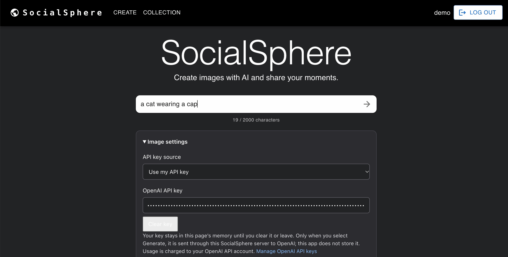
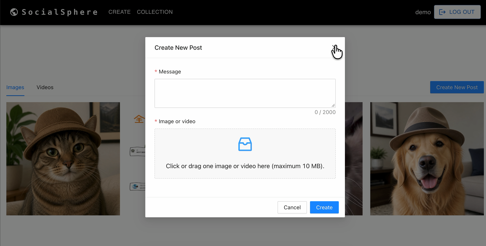
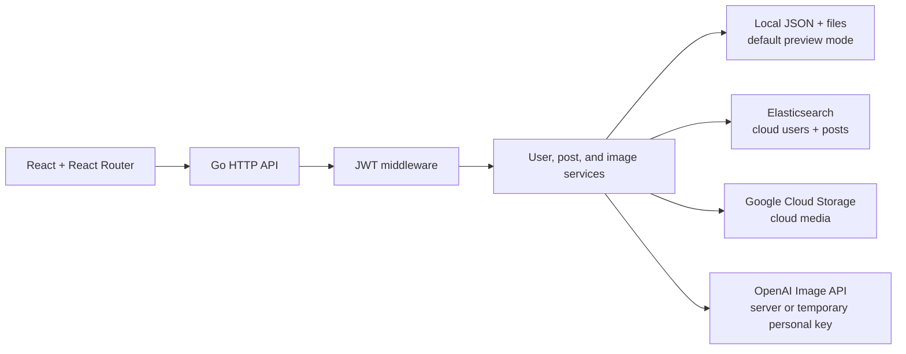

# SocialSphere

**An AI-powered social networking platform for creating images, sharing photo and video posts, and discovering posts by text or author.**

Originally developed in **August 2025** with **React, Go, JWT, Elasticsearch, Google Cloud, and OpenAI's DALL·E 3**, and deployed to Google Cloud. **The hosted application is now offline.** This repository contains the maintained version, including a local mode that lets you try the social features without cloud services.

[Demo](#demo) · [Features](#features) · [Architecture](#architecture) · [Run locally](#local-development) · [API](#api)



## Demo

[▶ Watch the SocialSphere demo](https://drive.google.com/file/d/1H6R5kVk7SKsjU4kpb23TPljHFBYTDQaB/view?usp=sharing)

## Features

| Feature | Experience |
| --- | --- |
| Accounts | Register, sign in, restore a login after refresh, and log out |
| AI image creation | Choose a supported image model, describe an image, preview it, and choose whether to publish it; use a configured server key or an opted-in temporary personal key |
| Photo and video posts | Upload media with a message, browse the image gallery, and play videos |
| Search and discovery | Browse recent posts, search message text, filter by author, or select **My posts** |
| Post ownership | Delete your own posts and their stored media; other users cannot delete them |

Uploads support JPEG, PNG, GIF, MP4, and WebM files up to **10 MiB**. Search returns up to 100 posts, ordered newest first. AI generation previews an image before publication; generating alone does not create a post.

<details>
<summary>View post creation and the media gallery</summary>



</details>

## Engineering highlights

- **React interface and routing:** React 18, React Router 6, Material UI, and Ant Design provide protected routes, account state, search, media views, and upload forms.
- **JWT authentication:** The Go API hashes passwords with BCrypt, issues expiring signed tokens, validates incoming tokens, and checks ownership before deleting posts. Logout clears the browser's token.
- **Storage adapters:** User, post, and media interfaces support local JSON/file persistence or cloud storage with Elasticsearch and Google Cloud Storage.
- **Backend AI integration:** Authenticated generation requests have model and prompt validation, rate limiting, timeouts, and validation of the returned image. A server-managed key or an opted-in personal key is used for the selected request; personal keys are not persisted by the application.
- **Media handling:** Uploads have size and content checks; images are decoded for validation. The application serves media through its own URLs and supports video byte-range requests.

## Architecture



Local and cloud storage are alternative configurations selected at startup. The default local preview does not connect to Elasticsearch or GCS; the cloud adapters preserve the project's original search and media-storage architecture. See [architecture and request flows](docs/architecture.md) for the complete diagram and [project history and résumé mapping](docs/project-notes.zh-CN.md) for the original implementation and maintenance changes.

## Tech stack

| Layer | Technologies |
| --- | --- |
| Frontend | React 18, React Router 6, Material UI, Ant Design |
| Backend | Go, Gorilla mux, JWT, BCrypt |
| Cloud storage and search | Elasticsearch, Google Cloud Storage |
| AI | OpenAI Image API; DALL·E 3 in the original 2025 implementation |
| Packaging and deployment | Docker, Docker Compose, Google Cloud deployment template |
| Testing | Go tests and race detector, Jest, React Testing Library |

## Repository layout

- `frontend/`: React 18, React Router 6, Material UI and Ant Design, plus frontend tests.
- `backend/`: Go API, storage adapters, authentication and integration tests.
- `Dockerfile` and `compose.yaml`: combined frontend/API image and a persistent local data volume.
- `.env.example`: server-side environment variable names with no private credentials.

## Local development

Requirements: Go 1.24.6 or newer and Node.js with npm. The verification environment used Go 1.27.3 and Node.js 24.

Start the API in one terminal:

```sh
cd backend
go run .
```

Start the frontend from a second terminal:

```sh
cd frontend
npm ci
npm start
```

Open http://localhost:3000. The development proxy forwards `/api` to `http://127.0.0.1:8080`; `API_PROXY_TARGET` can override that development target. The API also exposes its original root endpoint paths for compatibility.

Local mode is the default and does not require Elasticsearch, GCS or an AI key. Accounts, password hashes, posts and media persist under `backend/data/`. A private JWT signing key is generated there on first startup and reused after restart. That entire directory and its private files are ignored by Git.

## Run the combined image

With Docker Desktop running, from the repository root:

```sh
docker compose up --build
```

Open http://localhost:8080. Compose uses a named volume for local data; `docker compose down` stops the application while retaining that volume. This setup runs one local storage instance.

To build and serve the frontend manually instead, run `npm run build` in `frontend/`, then run `FRONTEND_DIR=../frontend/build go run .` in `backend/`.

## Optional AI configuration

The original 2025 implementation used DALL·E 3. [OpenAI has since removed DALL·E 3 from the API](https://developers.openai.com/api/docs/models/dall-e-3), so the maintained version uses the current Image API with a configurable model. The historical model name remains part of the original project record.

The server uses the [current Image API](https://developers.openai.com/api/reference/resources/images/methods/generate), requests PNG output, and returns validated image bytes as a data URL. Prompts accept 1–2000 Unicode characters. The model selector includes **GPT Image 2**, GPT Image 2.5 Sunburst / Flare, and GPT Image 2.6 Sunburst / Flare. Access depends on the API account's model permissions and available credits.

There are two ways to provide a key:

- **Server-managed key:** Copy `.env.example` to a private root `.env`, then set `OPENAI_API_KEY`. `OPENAI_IMAGE_MODEL` sets the default model (`gpt-image-2.5-sunburst`). The browser never receives this server key.
- **Personal key:** The operator must explicitly enable `ALLOW_USER_IMAGE_KEYS=true` and restart the application. A signed-in user can then open **Image settings**, select **Use my API key**, choose a model, and enter a key from their [OpenAI API account](https://platform.openai.com/api-keys). The personal-key option initially selects `gpt-image-2`.

Personal keys stay in the current page's React state until cleared or the page is left/refreshed. Clicking **Generate image** sends the key to this SocialSphere backend in a dedicated request header; the backend uses it for the OpenAI request. The application does not save personal keys to browser storage, cookies, its database, or files. It never falls back to the operator's server key when a personal-key request is missing a key. Generated requests consume the selected API account's quota; simply entering a key or changing a model does not call OpenAI.

Only enable personal keys on a server you trust, and use HTTPS for a hosted deployment. No user-supplied provider URL is accepted. A local preview at `localhost` can use HTTP. The personal-key feature is disabled by default.

Compose reads the root `.env` for interpolation. When launching Go directly, export the settings before starting the backend:

```sh
set -a
source .env
set +a
cd backend
go run .
```

A build-time `REACT_APP_OPENAI_KEY` is not used. Real generation requires a valid API key and access to the selected model. Without either key source, the UI explains the missing setup and the server-key endpoint returns an explicit 503 configuration message; uploads and other social features still work. The image endpoint has a per-instance budget of two initial requests and one additional request every 30 seconds. Verification uses a local simulated provider and does not make paid AI requests.

## Storage and deployment

The original project was successfully deployed to Google Cloud in 2025. That hosted application has since been taken offline. The instructions here reproduce the maintained application locally; a new cloud deployment requires configuring and validating the external services separately.

Set `STORAGE_MODE=cloud` to use Elasticsearch and GCS. Configure `ES_URL`, optional `ES_USERNAME` / `ES_PASSWORD`, `GCS_BUCKET` and a private random `JWT_SIGNING_KEY` of at least 32 bytes. GCS uses Application Default Credentials. Configure allowed browser origins through `CORS_ORIGINS` when using a separately hosted frontend.

The default cloud indexes are `socialsphere_users_v2` and `socialsphere_posts_v2`. Old indexes containing plaintext passwords need a separate reviewed migration/password reset; this version never falls back to plaintext password comparison.

Configure a private GCS bucket; the application does not set public object ACLs. Public social media is streamed through opaque application media URLs; search and mutations require authentication. Actual bucket visibility depends on its cloud IAM and ACL configuration. Local file storage is single-process; cloud mode shares users, posts and media across instances. All instances must use the same private JWT signing key.

`backend/app.yaml` is a deployment template with cloud mode and the public bind address explicit. Supply private cloud values in an ignored `backend/app.private.yaml` copy before deploying. No cloud resources are created by this repository, and the template has not been deployed here. An API-only deployment also needs separately hosted frontend assets or the combined image.

JWTs expire after 24 hours. Signing out clears the browser's stored token; it does not revoke an already copied token on the stateless server.

## API

The frontend uses the `/api` prefix. The original unprefixed paths remain available for compatibility.

| Method | Endpoint | Purpose | Authentication |
| --- | --- | --- | --- |
| POST | `/api/signup` | Create an account with a username and password | Public |
| POST | `/api/signin` | Sign in and obtain a JWT | Public |
| GET | `/api/me` | Verify the current account | Bearer JWT |
| POST | `/api/upload` | Publish a message and one media file | Bearer JWT |
| GET | `/api/search` | Recent posts; optional `keywords`, `user`, and `limit` filters | Bearer JWT |
| DELETE | `/api/post/{id}` | Delete an owned post and its media | Bearer JWT |
| GET | `/api/image-config` | Available models and enabled key sources, excluding secrets | Bearer JWT |
| POST | `/api/generate-image` | Generate from `prompt`, optional `model`, and `key_source` | Bearer JWT |
| GET / HEAD | `/api/media/{id}` | Read a posted image or video | Public |
| GET | `/api/health` | Check application health | Public |

Logout is handled by clearing the client-side token; there is no server-side logout endpoint.

For generation, `key_source` is `server` (the compatibility default) or `personal`. Personal-key requests require `X-OpenAI-Api-Key`; the existing `Authorization: Bearer ...` header continues to authenticate the SocialSphere account. Image configuration and generation responses are marked `Cache-Control: no-store`.

## Tests and verification

```sh
cd backend
go test -race ./...
go vet ./...
go build .
```

```sh
cd frontend
npm ci
npm test -- --watchAll=false --runInBand
CI=true npm run build
```

Verified on 2026-11-04:

- 36 frontend tests passed across 4 suites; strict production build succeeded.
- 34 Go test functions and their parameterized subtests passed (60 pass events), including the race detector; vet and binary build succeeded.
- Live local HTTP checks passed for the combined UI/API, registration, JWT login, upload, recent search, media byte ranges, author-only deletion and actual development proxy forwarding.
- Restart preserved accounts, posts, media and the signing key. Owner deletion removed stored media. The application was stopped after testing.

Preview verification on 2026-11-05:

- The current frontend production build succeeded after the brand metadata update.
- The combined local UI/API served the SocialSphere interface. Signup, login, session restoration, upload, text search, author filtering, media reads, and deletion were checked.
- Without an AI key, the generation endpoint returned its explicit configuration message; no paid AI request was made.

Personal-key and model-selection verification on 2026-11-05:

- All 46 frontend tests passed, including personal-key handling, model selection, clearing keys, and the existing preview/publish flow; the production build succeeded.
- The backend race-enabled test suite, vet, and binary build passed. Simulated-provider tests cover credential isolation, model validation, redirects, missing-key rejection, and safe provider errors.
- The local preview exposes the supported models and explicitly enabled personal-key option. Missing credentials and invalid requests are rejected before contacting OpenAI.

Live generation with a real personal API key remains dependent on the user's account and has not been performed during this verification.

Elasticsearch adapter tests use a local simulated HTTP service; GCS configuration and reader cleanup are tested locally. Neither adapter was connected to live cloud services during maintenance verification. The current Docker image and a new cloud deployment were not run; real AI generation was not called. See [project history and résumé mapping](docs/project-notes.zh-CN.md) for the original project and maintenance scope.
