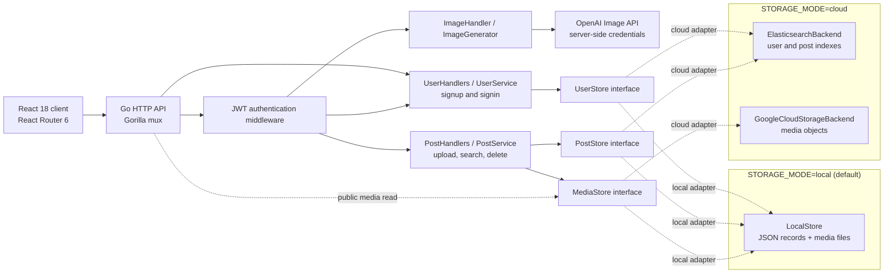
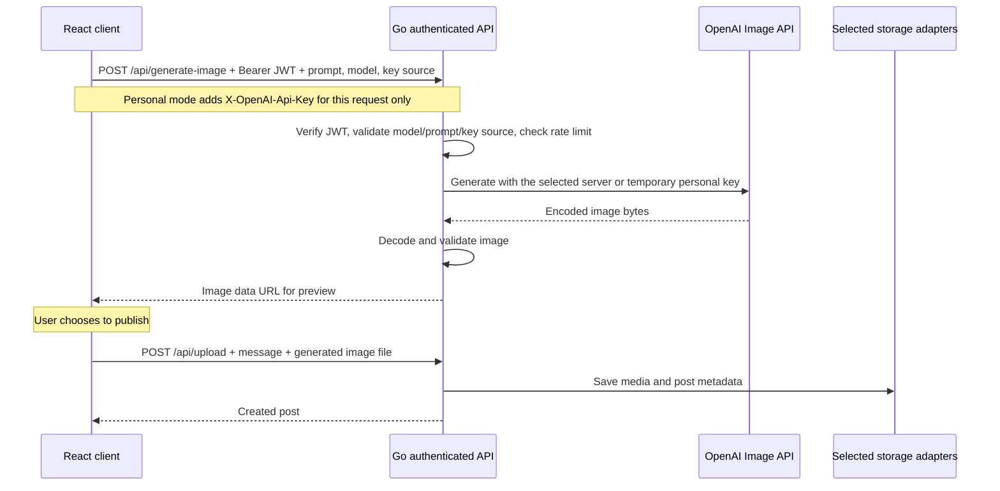

# SocialSphere Architecture

SocialSphere is a React and Go social application for image/video posts, text and username search, and AI-assisted image creation. The backend separates HTTP handlers, application services, and storage adapters so the same social features can run with local persistence or Elasticsearch and Google Cloud Storage.

## System overview

[`main.go`](../backend/main.go) selects one storage mode at startup and injects its adapters into the services. Local and cloud storage are alternatives, not simultaneous writes or automatic failover. AI generation is an independent optional backend integration available in either storage mode.

## Frontend and HTTP routing

The frontend uses React 18, React Router 6, Material UI, and Ant Design. [`Main.js`](../frontend/src/components/Main.js) defines login, registration, image creation, and collection routes using `Routes`, `Route`, and `Navigate`. Logged-out visitors are redirected to login for protected pages; the backend separately enforces authentication.

[`api.js`](../frontend/src/api.js) centralizes API calls, attaches the Bearer token to authenticated requests, translates server errors, validates uploads, and handles expired authentication. Requests default to the `/api` prefix. [`router.go`](../backend/handler/router.go) also exposes the original unprefixed endpoint paths for compatibility.

The [Docker build](../Dockerfile) packages the React production bundle and Go binary into one image. The Go server serves the static frontend and falls back to `index.html` for client-side routes. During development, [`setupProxy.js`](../frontend/src/setupProxy.js) forwards `/api` calls from the React server to Go.

## Authentication

[`UserService`](../backend/service/user.go) normalizes usernames and validates account input. Passwords are stored as BCrypt hashes through the `UserStore` interface. Username creation is atomic in both storage adapters, so a duplicate signup does not overwrite an existing account.

[`Authenticator`](../backend/handler/auth.go) issues HS256 JWTs with a 24-hour lifetime. Verification checks the signature algorithm, issuer, subject, username, issue time, and expiration before adding the authenticated username to the request context. Private routes include `/me`, `/upload`, `/search`, `/post/{id}`, and `/generate-image`.

The browser keeps its JWT in `localStorage`, verifies a restored login through `/me`, and clears its token on expiry, an authentication failure, or logout. Logout is a client-side operation: the stateless backend does not revoke a token that has already been copied elsewhere.

In local mode, the server creates and persists a private signing key if `JWT_SIGNING_KEY` is absent. Cloud mode requires an explicit private signing key shared by all application instances.

## Posts, search, and media

[`PostService`](../backend/service/post.go) owns upload validation, post creation, search, and author-only deletion. It depends on two interfaces:

- `PostStore` saves, reads, searches, and deletes post metadata.
- `MediaStore` saves, opens, and deletes the corresponding media bytes.

Posts accept a message of 1–2000 Unicode characters and one JPEG, PNG, GIF, MP4, or WebM file up to 10 MiB. The backend checks detected content types; images are decoded and checked against dimension and pixel limits. Video uploads receive header/type and size checks rather than full video decoding.

New posts receive UUIDs and creation timestamps. Media URLs point to `/api/media/{id}`, and the application serves media through its storage adapter. These social-media read URLs are public; authenticated search and ownership checks do not make the media URLs private.

Creating a post saves its media first and then its metadata. If metadata persistence fails, the service attempts to remove the uploaded media. Deletion checks the authenticated author, removes the media, and then deletes metadata. Operations across Elasticsearch and GCS are not a distributed transaction.

### Storage modes

| Concern | Local mode | Cloud mode |
| --- | --- | --- |
| Adapter selection | `LocalStore` implements all three storage interfaces | `ElasticsearchBackend` implements `UserStore` and `PostStore`; `GoogleCloudStorageBackend` implements `MediaStore` |
| User and post records | In-memory maps persisted to `state.json` using a temporary file and rename | Separate configurable Elasticsearch indexes |
| Media | Files below the private data directory | GCS objects; the adapter does not set public object ACLs |
| Text search | Case-insensitive matching of all supplied terms within the message | Elasticsearch `match` query on the message field with `AND` |
| Username filter | Exact normalized username | Elasticsearch `term` filter |
| Recent posts | Sort by creation time, then post ID | Sort by creation time, then post ID |
| Intended runtime | Single-process local development and preview | Shared external stores, with credentials and infrastructure configured separately |

The adapters are implemented in [`local.go`](../backend/backend/local.go), [`elasticsearch.go`](../backend/backend/elasticsearch.go), and [`gsc.go`](../backend/backend/gsc.go). They expose the same service interfaces, but local matching and Elasticsearch's analyzed text queries need not produce identical search results.

Cloud mode requires `ES_URL`, `GCS_BUCKET`, Google Application Default Credentials, and a private `JWT_SIGNING_KEY`; Elasticsearch credentials and index names are configurable. Existing indexes are retained at startup. Old user records containing plaintext passwords need an explicit migration or password reset before they can be used with BCrypt authentication.

The GCS adapter leaves access policy to bucket configuration and the application's media route. A private bucket must be configured through cloud IAM/access settings; omitting public-ACL changes in code does not itself change an existing bucket's policy.

## Authenticated AI generation

The frontend sends a prompt to Go instead of calling the provider directly. [`ImageHandler`](../backend/handler/post.go) requires authentication and applies one rate limiter per application instance: a burst of two requests, replenished by one request every 30 seconds. [`OpenAIImageGenerator`](../backend/service/image.go) calls the fixed OpenAI image-generation endpoint, bounds the response, and validates returned image bytes before building a data URL.

[`Landing.js`](../frontend/src/components/Landing.js) displays the generated image for preview. Publishing converts that data URL into a file and uses the same validated upload flow as other posts. Generation alone does not publish a post.

`OPENAI_API_KEY` and `OPENAI_IMAGE_MODEL` configure the server-managed integration. The server key is not sent to the browser. A JWT-protected `/api/image-config` endpoint reports configuration status, permitted key sources, and the curated model list without exposing credentials.

Operators can opt into personal keys with `ALLOW_USER_IMAGE_KEYS=true`; this capability is disabled by default. In personal mode, React holds the key only in the current `Landing` component state and sends it in `X-OpenAI-Api-Key` when the user explicitly generates an image. Go uses request-local credentials for that provider call; it does not mutate the configured server generator or persist the key. A missing personal key is rejected rather than falling back to a server key. Responses from image configuration and generation are marked `Cache-Control: no-store`.

The page explains that the key is sent to this SocialSphere backend and then OpenAI, and that requests use the selected API account's quota. Models must be in the supported list, and account access still determines whether a live request succeeds. Without either key source, generation remains unavailable while regular uploads and other social features work. Tests use simulated providers and never require real API keys.

## Project history and the current repository

SocialSphere was originally developed in August 2025 and deployed to Google Cloud. The author has confirmed that the hosted application is now offline. The current local preview demonstrates the maintained application; a new cloud deployment would require separate configuration and verification.

The following distinctions keep the current implementation aligned with that history:

- The original image-generation implementation used DALL·E 3. The maintained version routes generation through an authenticated Go backend and makes the model configurable. A description of the original project should retain its historical model name without implying the current backend uses the original client-side integration.
- The checked-in frontend uses React Router **6.30.1**. The preserved original frontend snapshot also uses Router 6 APIs. A resume reference to Router v4 is inconsistent with the available source and should be reconciled; the dependency should not be downgraded just to match the wording.
- Elasticsearch and GCS remain implemented cloud adapters. The default local mode enables a reproducible preview without requiring those external services; it does not remove the cloud architecture from the project.
- [`app.yaml`](../backend/app.yaml) is a Google App Engine flexible-environment deployment template. The existence of a template and a historical deployment record are separate from validating a new deployment of the maintained version.

## Verification boundaries

The backend includes tests for authentication, post ownership, upload validation, local persistence, Elasticsearch request construction, GCS configuration/reader cleanup, and AI request/response behavior. Elasticsearch tests use a simulated HTTP server, and AI tests use a simulated provider. These tests do not perform a live cloud deployment or a paid AI-generation request.

A local preview should identify the active storage mode and whether real AI credentials are configured. Cloud connectivity, bucket permissions, and a live provider response require separate integration checks. No throughput, scaling, or production-load measurement follows from the local regression suite.
